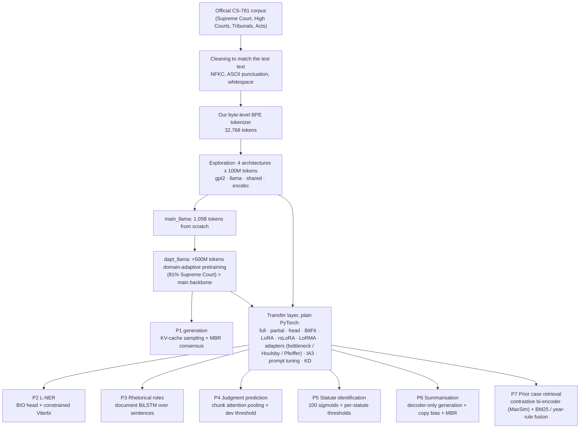

# CS781 Capstone Project — In-House Legal Intelligence System

A confidential, self-hosted NLP system for Indian court judgments, built in **seven phases** on **our own legal language model trained from scratch**. There are no pretrained language models, no external corpora and no commercial APIs. Phase 1 builds the tokenizer and four language models. Phases 2–7 load our Phase-1 checkpoints and adapt them to six legal tasks, using fine-tuning and parameter-efficient techniques implemented from scratch in plain PyTorch in this repository (no PEFT or model library).

| | |
|---|---|
| **Course** | CS781 Capstone Project, IIT Kanpur |
| **Data** | Only the official `Exploration-Lab/CS-781-Capstone` dataset (one configuration per phase) |
| **Compute** | Kaggle notebooks, 2 × NVIDIA Tesla T4 (16 GB each) |
| **Software** | Python 3, PyTorch 2.11 (CUDA 12.8), Hugging Face `tokenizers` and `huggingface_hub`. See [`requirements.txt`](requirements.txt). |
| **Weights and outputs** | Hugging Face `Abhayk24/cs781-p1-data` (dataset) and `Abhayk24/cs781-p1-ckpt` (model). See [Where the weights are](#8-where-the-weights-and-outputs-are). |
| **Evaluation** | The official evaluator of each phase (`evaluate_phaseN.py`, an identical copy in each folder) and the Codabench test leaderboard |

---

## Contents

1. [Results](#1-results-official-codabench-test-scores)
2. [System architecture](#2-system-architecture)
3. [Phase-1 foundation: tokenizer and four language models](#3-phase-1-foundation-tokenizer-and-four-language-models)
4. [Transfer methodology: fine-tuning and PEFT techniques](#4-transfer-methodology-fine-tuning-and-peft-techniques)
5. [Phase-by-phase documentation](#5-phase-by-phase-documentation) (task, method, files, how to run, every submission)
6. [Repository structure](#6-repository-structure)
7. [Setup and execution](#7-setup-and-execution)
8. [Where the weights and outputs are](#8-where-the-weights-and-outputs-are)
9. [Submission validity and reproducibility](#9-submission-validity-and-reproducibility)
10. [References](#10-references)

---

## 1. Results (official Codabench test scores)

| Phase | Task | Primary metric | Best test score | Best submission (`submissions/`) | Valid submissions |
|---|---|---|---|---|---|
| 1 | Legal LM pretraining: continue a 512-word prompt with 128 words | BERTScore F1 | **0.8412** | `dapt_llama` + MBR over 34 candidates | 8 |
| 2 | Legal named entity recognition (L-NER) | strict macro-F1 | **0.6410** | `ens_top8` (8 fine-tuned models) | 15 |
| 3 | Rhetorical role prediction | macro-F1 | **0.5550** | `ens_top8` (round 5) | 14 |
| 4 | Court judgment prediction (CJPE) | macro-F1 | **0.7401** | `ens_greedy` (round 2) | 8 |
| 5 | Legal statute identification (multi-label) | macro-F1 | **0.4107** | `ens_greedy` (round 2) | 9 |
| 6 | Abstractive summarisation | BERTScore F1 | **0.8476** | `ens_mbr5` (round 3) | 7 |
| 7 | Prior case retrieval (PCR) | Micro-F1@7 | **0.4566** | `p7_llama_lorma` | 5 |
| | | | | **Total** | **66** |

**Best single model in each phase**, all built on our Phase-1 `dapt_llama`:

| Phase | Model | Score |
|---|---|---|
| P2 | `p2_llama_lorma` | 0.5819 |
| P3 | `p5_llama_lorma_lr3e4` | 0.5204 |
| P4 | `r2_llama_lorma_last1024` | 0.7349 |
| P5 | `r2_llama_partial_hier_cont` | 0.4011 |
| P6 | `fin_r3_llama_lorma_leadcentral768` | 0.8443 |
| P7 | `p7_llama_lorma` | 0.4566 |

Section 5 lists every submission of every phase.

---

## 2. System architecture



Plain-text version:

```
                      Phase 1: tokenizer + 4 LMs from scratch (best: dapt_llama)
                                              |
                 transfer layer (LoRMA, LoRA, adapters, IA3, KD, ... in plain PyTorch)
                                              |
      -------------------------------------------------------------------------------
      |            |               |              |              |                 |
 P2 L-NER      P3 roles      P4 judgment     P5 statutes     P6 summaries     P7 retrieval
 BIO head +    doc BiLSTM    attention-pool  100 sigmoids    decoder-only     bi-encoder
 Viterbi       over          head + dev      + per-statute   generation +     (MaxSim) +
               sentences     threshold       thresholds      MBR decoding     BM25 fusion
```

**Design principles used in Phases 2–7:**

1. Each phase loads a Phase-1 checkpoint from Hugging Face and adds a small task head.
2. The text is cleaned exactly as in Phase 1 so that our tokenizer sees familiar input. Where character offsets matter (Phase 2), an exact character map back to the original text is kept.
3. **LoRMA** (compulsory) and **knowledge distillation** (llama teacher → the 2× smaller `explore_shared` student) are run in every phase from 2 to 7.
4. All four Phase-1 models are compared in Phases 2–6. Phase 7 uses llama and the shared KD student.
5. Model selection uses only a held-out dev or validation split, scored with the official evaluator. The test set is used only through Codabench.
6. Long judgments are handled by explicit reading strategies: sliding windows, first/last chunks, hierarchical chunks with attention pooling, important-sentence selection, or multi-window MaxSim.

---

## 3. Phase-1 foundation: tokenizer and four language models

### 3.1 Data preparation and tokenizer

The data notebook is `phase1_legal_lm/1_data_prep_and_tokenizer.ipynb`. It runs on CPU.

**Cleaning.** The text is cleaned to match the test prompts:
- NFKC normalisation
- curly quotes and dashes converted to ASCII
- non-ASCII characters dropped
- whitespace collapsed
- documents under 50 words removed

**Splits.** A hash-based train/val/dev split (seed 1234) is made. A 479-example test-like dev set is built: 512-word prompt → 128-word continuation.

**Tokenizer.** A custom byte-level BPE, trained in this project on the cleaned official corpus:
- vocabulary 32,768
- 16 special tokens
- fertility 1.197 tokens per word on the 1,000 test prompts, so a 512-word prompt is about 613 tokens

**Storage.** Everything is tokenised once into `uint16` `.bin` files and uploaded to `Abhayk24/cs781-p1-data`.

### 3.2 Architectures (`phase1_legal_lm/model.py`, written from scratch, no model library)

Shared by all four models:
- vocabulary 32,768
- hidden size 768, 12 heads (head size 64)
- context 1,024
- pre-norm residual blocks and tied input/output embeddings
- PyTorch SDPA attention and a hand-written KV-cache decoder

| | GPT-2 style (`explore_gpt2`) | **Llama style (`dapt_llama`, chosen)** | Shared, lightweight (`explore_shared`) | Encoder–decoder (`explore_encdec`) |
|---|---|---|---|---|
| Parameters | 111.01M | **107.76M** | 58.73M | 117.20M |
| Layers | 12 decoder | 12 decoder | 6 unique blocks applied twice (12 passes) | 6 encoder + 6 decoder |
| Positions | learned | RoPE | RoPE | RoPE |
| Norm | LayerNorm | RMSNorm | RMSNorm | RMSNorm |
| MLP | GELU 3072 | SwiGLU 2304 | SwiGLU 3072 | SwiGLU 2304 |
| Attention | MHA (12 KV heads) | GQA (4 KV heads) | MQA (1 KV head) | GQA (4) + cross-attention |
| Embedding | 32,768 × 768 | 32,768 × 768 | factorised 32,768 → 256 → 768 | 32,768 × 768 |

**Parameter cap.** All four models are inside the competition's 50M–300M bound. The count is `sum(p.numel() for p in model.parameters())`, with tied embeddings counted once, and `train.py` refuses to start a model outside 50M–300M (`assert 50e6 <= num_params <= 300e6`).

### 3.3 Pretraining (`phase1_legal_lm/train.py`)

| Run | Start | Tokens | Peak LR / schedule | Dev perplexity |
|---|---|---|---|---|
| `explore_llama` / `explore_gpt2` / `explore_encdec` / `explore_shared` | random | 100M each, same data | 6e-4 | **19.3** / 26.3 / 35.9 / 42.9 |
| `main_llama` | random | 1.05B (4,005 steps × 262,144 tokens), 2× T4 DDP, about 8.2 h | 6e-4, 4% warm-up, cosine to 6e-5 | 9.09 |
| **`dapt_llama`** | `main_llama` | +500M, 81% Supreme Court | 2e-4, cosine to 2e-5 | **8.47** |

**Optimiser and precision.** AdamW (β = 0.9 / 0.95, weight decay 0.1), mixed precision, gradient clipping at 1.0.

**Monitoring.** Periodic evaluation; validation chunks are kept per source.

**Fault tolerance.** Checkpoints are written regularly to Hugging Face, so a killed Kaggle session resumes from the last checkpoint. `--init_from` starts DAPT from `main_llama`.

### 3.4 Generation (`phase1_legal_lm/infer.py`)

- KV-cache sampling: temperature 0.5, top-p 0.9, repetition penalty 1.1.
- Each output is forced to exactly 128 words; short outputs get extra passes.
- **MBR consensus decoding:** many candidate continuations are sampled, and the one that agrees most with the others is kept.
- Improvement: one sample 0.8324 → MBR over 8 candidates 0.8375 → `dapt_llama` with MBR over 12 candidates 0.8390 → MBR over 34 candidates **0.8412**.

---

## 4. Transfer methodology: fine-tuning and PEFT techniques

All techniques are implemented from scratch in plain PyTorch inside each phase's script (`p2ner.py`, `p3rr.py`, `p4cj.py`, `p5ls.py`, `p6sum.py`, `p7ret.py`). No PEFT library is used.

| Technique | What is trained | Implementation detail |
|---|---|---|
| **Full fine-tuning** | all weights + head | low LR (2e-5 to 1e-4) |
| **Partial / layer-wise FT** | top 4 of 12 layers + final norm + head | lower layers frozen |
| **Frozen backbone + head** (linear probe) | head only | backbone used as a fixed feature extractor |
| **BitFit** | biases and norm parameters + head | our backbone has bias-free linears, so a zero-initialised trainable bias is added |
| **LoRA** | low-rank A, B on q, k, v, o (+ MLP in P6) | `W' = W0 + (α/r)·B·A`, r 16, α 32, B = 0 at start |
| **rsLoRA** | as LoRA | rank-stabilised scaling `α/√r` (r 64, α 16) |
| **LoRMA** (compulsory) | low-rank A, B | **multiplicative**: `W' = (I + (α/r)·B·A)·W0`, computed as `y = W0x + (α/r)·B·A·(W0x)`. r 16, α 32, B = 0 at start, so training starts exactly at the Phase-1 model. Applied to q, k, v, o (+ gate, up, down in P6/P7). |
| **Bottleneck adapter** | 768 → 64 → 768 module on a sub-layer's output (`y + Up(GELU(Down(y)))`) | zero-initialised up-projection, so training starts at the Phase-1 model |
| **Houlsby adapter** | adapters after the attention output and after the MLP output | as in Houlsby et al. 2019 |
| **Pfeiffer adapter** | one adapter after the MLP only | as in Pfeiffer et al. 2021 |
| **IA³** | learned scaling vectors on keys, values and the feed-forward hidden activations | vectors start at 1 |
| **Prompt tuning** | 20 soft-prompt vectors prepended to the input | backbone frozen |
| **Knowledge distillation (KD)** | the `explore_shared` student (58.7M) | llama teacher (107.8M) → student, `L = α·task_loss + (1−α)·T²·KL(teacher ‖ student)`, α 0.5, T 2 (task-specific forms per phase in section 5) |

**Technique × phase matrix** (✓ = implemented, trained and scored on dev with the official evaluator):

| Technique | P2 | P3 | P4 | P5 | P6 | P7 |
|---|:-:|:-:|:-:|:-:|:-:|:-:|
| Full fine-tuning | ✓ | ✓ | ✓ | ✓ | ✓ | ✓ |
| Partial (top layers) | | | ✓ | ✓ | | ✓ |
| Frozen backbone + head | ✓ | ✓ | ✓ | | | ✓ (no training) |
| BitFit | | | ✓ | | | |
| LoRA | ✓ | ✓ | | | ✓ | |
| rsLoRA | | ✓ | | | | |
| **LoRMA** | ✓ | ✓ | ✓ | ✓ | ✓ | ✓ |
| Bottleneck adapters | | | ✓ | ✓ | | |
| Houlsby / Pfeiffer adapters | | | | | ✓ | |
| IA³ | | ✓ | | | | ✓ |
| Prompt tuning | | | | ✓ | | |
| **Knowledge distillation** | ✓ | ✓ | ✓ | ✓ | ✓ | ✓ |
| Phase-1 models compared | all 4 | all 4 | all 4 | all 4 | all 4 + a no-Phase-1 ablation | llama + shared |

**Ensembling** is done only after the single models are scored on dev:
- probability averaging (P2–P5)
- MBR consensus over generated summaries (P6)
- fusion of z-scored ranking signals (P7)

Members are chosen by a fixed rule (top-K by dev) or by greedy forward selection on dev.

---

## 5. Phase-by-phase documentation

Each phase folder has its own `README.md` with more detail. Every phase follows the same Kaggle notebook pattern:

| Cell | What it does |
|---|---|
| 1 | Hugging Face login, download our tokenizer |
| 3 | Build or download the token cache (P4–P7) |
| 7 | `%%writefile` the Python files, run a short **safety test on the real data**, then train all runs on both GPUs. Runs already saved on Hugging Face are **skipped**, so a killed session resumes. |
| 8 | Results table with the official evaluator on dev, `submission.zip` files |
| 9 | Ensembles and the submission order |

### Phase 1 — Legal language model pretraining

- **Task:** continue each of 1,000 test prompts (512 words of a judgment) with exactly 128 words.
- **Output:** `prediction.json` = `{id: continuation}`.
- **Metric:** BERTScore F1 (primary), ROUGE-L, BLEU-4.

**Method.** See section 3: exploration of 4 architectures → `main_llama` → `dapt_llama` → MBR decoding.

**Files.**

| File | Role |
|---|---|
| `1_data_prep_and_tokenizer.ipynb` | NB1: cleaning, splits, dev set, BPE tokenizer, token files |
| `2a_train_explore_4_architectures_100M.ipynb` | NB2, mode `explore` |
| `2b_train_main_llama_1.05B.ipynb` | NB2, mode `main` |
| `2c_train_dapt_llama_plus500M.ipynb` | NB2, mode `dapt` |
| `3a_infer_main_llama_sub1_sub2.ipynb` | NB3: submissions 1–2 |
| `3b_infer_explore_models_sub3_to_6.ipynb` | NB3: submissions 3–6 |
| `3c_infer_dapt_llama_MBR12_sub7.ipynb` | NB3: submission 7 |
| `3d_infer_dapt_llama_MBR34_sub8_FINAL.ipynb` | NB3: **submission 8, best** |
| `model.py` | the four architectures |
| `train.py` | pretraining loop |
| `infer.py` | generation and MBR |
| `evaluate_phase1.py` | official evaluator |

**How to run.** Run NB1 on CPU. Then run NB2 three times, setting `MODE` in cell 1 to `explore`, then `main`, then `dapt`. Then run NB3, the notebook of the wanted submission. Use Kaggle secret `HF`.

**Submissions:**

| # | Model (training tokens) | Decoding | Test BERTScore F1 |
|---|---|---|---|
| 1 | `main_llama` (1.05B) | 1 sample (T 0.5, top-p 0.9, rep. 1.1) | 0.8324 |
| 2 | `main_llama` (1.05B) | MBR over 8 samples | 0.8375 |
| 3 | `explore_gpt2` (100M) | 1 sample, same settings as #1 (dev 0.8266) | 0.8189 ¹ |
| 4 | `explore_shared` (100M) | 1 sample, same settings as #1 (dev 0.8258) | 0.8228 ¹ |
| 5 | `explore_encdec` (100M) | 1 sample, same settings as #1 (dev 0.8210) | 0.8247 ¹ |
| 6 | `explore_llama` (100M) | 1 sample, same settings as #1 (dev 0.8272) | 0.8234 ¹ |
| 7 | `dapt_llama` (1.05B + 0.5B) | MBR over 12 samples | 0.8390 |
| **8** | **`dapt_llama` (1.05B + 0.5B)** | **MBR over 34 candidates** (32 new samples on 2 GPUs + the 2 previous MBR winners) | **0.8412** |

¹ Submissions 3–6 compare the four architectures on the test set. Each was trained on the same 100M tokens and uses the same decoding. Submissions are numbered in upload order (Codabench IDs 961514, 961543, 961584, 961614 on 5 Oct 2026), and the four zips were uploaded in the order the notebook wrote them: gpt2, shared, encdec, llama. On our dev set the four are within 0.007 of each other, and on test all four are below the 1.05B-token `main_llama` (0.8324).

---

### Phase 2 — Legal named entity recognition (L-NER)

- **Task:** for each entity in a judgment, predict the exact start character, end character and label.
- **Labels (12):** APP, RESP, A.COUNSEL, R.COUNSEL, JUDGE, WIT, AUTH, COURT, PREC, STAT, DATE, CASENO.
- **Metric:** strict macro-F1 (start, end and label must all match).
- **Data:** 70 labelled documents (8,393 entities) and 35 test documents. 10 documents are held out as a label-balanced validation split.

**Architecture.**
- Phase-1 backbone, read bidirectionally (no causal mask) unless the run name says `causal`.
- Dropout, then a linear (or BiLSTM) head over 25 BIO tags.
- Inference: sliding windows of 1,024 tokens (step 512) with centre-weighted averaging → constrained BIO Viterbi → document-level label propagation → offsets mapped back to the original text through `p2text.py`'s character map.

**Techniques.** Full FT, frozen backbone + head, LoRA, **LoRMA**, **KD** (`α·CE + (1−α)·T²·KL`, α 0.5, T 2).

**Training.**
- AdamW, fp16, 6% warm-up + cosine.
- 512-token random windows.
- Loss weights √(inverse tag frequency).
- Early stopping on validation strict macro-F1.

**Files.**

| File | Role |
|---|---|
| `P2_LNER_final.ipynb` | the whole phase |
| `p2text.py` | cleaning with an exact character map, token/character alignment |
| `p2ner.py` | one experiment |
| `p2ens.py` | ensembles |
| `model.py` | Phase-1 model code |
| `evaluate_phase2.py` | official evaluator |

**How to run.** Run `P2_LNER_final.ipynb` top to bottom (secret `HF` or `HF_TOKEN`). Cell 9 builds `ens_top8`.

**Submissions (15 distinct; `ens_all` was uploaded twice):**

| # | Submission | Kind | Phase-1 model(s) / technique | Val F1 | Test F1 |
|---|---|---|---|---|---|
| **1** | **`ens_top8`** | ensemble of 8 | llama + shared: LoRMA, LoRA, BiLSTM, full FT, causal, 2 KD | — | **0.6410** |
| 2 | `ens_top8_twins` | ensemble of 16 | top-8 + full-data twins | — | 0.6317 |
| 3 | `ens_top5` | ensemble of 5 | llama + shared | 0.6365 | 0.6272 |
| 4 | `ens_all` | greedy + twins | llama | 0.6823 | 0.6191 |
| 5 | `ens_top5_twins` | ensemble of 11 | llama + shared | 0.6365 | 0.6171 |
| 6 | `ens_val` | greedy, 2 models | llama | 0.6823 | 0.6100 |
| 7 | `p2_llama_lorma` | single | `dapt_llama`, **LoRMA** | 0.6074 | 0.5819 |
| 8 | `p2_llama_lorma_w1024_all` | single (twin) | LoRMA, 1,024 window, all 70 docs | — | 0.5600 |
| 9 | `p2_llama_lorma_w1024_all_s14` | single (twin) | same, seed 14 | — | 0.5588 |
| 10 | `p2_llama_lorma_w1024` | single | LoRMA, 1,024 window | 0.6335 | 0.5576 |
| 11 | `p2_shared_kd_lorma` | single | `explore_shared`, **KD** from llama LoRMA | 0.5718 | 0.5317 |
| 12 | `p2_shared_kd` | single | `explore_shared`, KD from llama full FT | 0.5316 | 0.5042 |
| 13 | `p2_gpt2_full_causal` | single | `explore_gpt2`, full FT, causal | 0.4416 | 0.4027 |
| 14 | `p2_encdec_lora` | single | `explore_encdec`, LoRA | 0.3813 | 0.3462 |
| 15 | `p2_gpt2_full` | single | `explore_gpt2`, full FT, bidirectional | 0.2174 | 0.1852 |

---

### Phase 3 — Rhetorical role prediction

- **Task:** label every sentence of a judgment with one of 13 roles, in order: Fact, Issue, ArgumentPetitioner, ArgumentRespondent, Statute, Dissent, PrecedentReliedUpon, PrecedentNotReliedUpon, PrecedentOverruled, RulingByLowerCourt, RatioOfTheDecision, RulingByPresentCourt, None.
- **Domains:** CL (competition law) and IT (income tax).
- **Metric:** macro-F1.

**Architecture (final, `ctx doc`).**
1. The whole judgment is read in 512-token windows (1,024 in round 5) by the Phase-1 backbone.
2. Token vectors are pooled into a sentence vector.
3. A **2-layer BiLSTM over all sentences of the document**, plus sentence position and domain, predicts each role.

Round 1 compared `sent` (sentence alone), `win` (512-token window) and `win+lstm`.

**Techniques.** **LoRMA**, LoRA, rsLoRA, IA³, full FT, head-only, **KD** (llama + LoRMA teacher → shared student, α 0.5, T 2).

**Rounds.**

| Round | What changed | Best dev |
|---|---|---|
| 1 | all techniques × 4 models | 0.4732 |
| 2 | whole-document model | 0.4987 |
| 3 | longer training, 2nd seed, Viterbi decoding | 0.4866 |
| 4 | feed-forward adapters, label smoothing | 0.4847 |
| 5 | 1,024-token windows, more seeds | 0.5003 |

**Files.**

| File | Role |
|---|---|
| `P3_round1.ipynb` … `P3_round5.ipynb` | one notebook per round; identical except `ROUND = N` in Cell 7 |
| `executed_notebooks/` | rounds 2–5 as run, with outputs; the round-2 notebook also prints the round-1 runs and their scores |
| `p3rr.py` | one experiment |
| `p3ens.py` | ensembles |
| `p2text.py` | cleaning, shared with Phase 2 |
| `model.py` | Phase-1 model code |
| `evaluate_phase3.py` | official evaluator |

**How to run.** Run `P3_round5.ipynb` (secret `HF_TOKEN` or `HF`). Earlier rounds' runs are reused from Hugging Face.

**Submissions (14):**

| # | Submission | Kind | Phase-1 model / technique | Dev F1 | Test F1 |
|---|---|---|---|---|---|
| **1** | **`ens_top8` (round 5)** | ensemble of 8 | llama: 5 LoRMA + 3 LoRA | 0.5126 | **0.5550** |
| 2 | `ens_r4_top8` (round 4) | ensemble of 8 | llama | — | 0.5478 |
| 3 | `ens_greedy` (round 2) | ensemble | — | 0.5174 | 0.5476 |
| 4 | `ens_greedy` (round 3) | ensemble | — | 0.5174 | 0.5476 |
| 5 | `ens_top8` (round 3) | ensemble of 8 | llama | 0.5067 | 0.5473 |
| 6 | `ens_top5` (round 5) | ensemble of 5 | llama | 0.5157 | 0.5419 |
| 7 | `ens_top8` (round 2) | ensemble of 8 | llama + gpt2 | — | 0.5396 |
| 8 | `ens_greedy` (round 5) | ensemble of 4 | llama + gpt2 | 0.5254 | 0.5245 |
| 9 | `p5_llama_lorma_lr3e4` | single | `dapt_llama`, **LoRMA** | 0.5003 | 0.5204 |
| 10 | `ens_top5_seq` (round 3) | ensemble + Viterbi | llama | — | 0.5108 |
| 11 | `best1_seq` (round 3) | single + Viterbi | llama | 0.5070 | 0.5006 |
| 12 | `p3_gpt2_lorma` | single | `explore_gpt2`, LoRMA | 0.4490 | 0.4625 |
| 13 | `p3_shared_kd` | single | `explore_shared`, full FT + **KD** | 0.4069 | 0.4268 |
| 14 | `p3d_encdec_lorma` | single | `explore_encdec`, LoRMA | 0.3416 | 0.3024 |

---

### Phase 4 — Court judgment prediction (CJPE)

- **Task:** predict the binary outcome (0/1) of a case from its text.
- **Metric:** macro-F1.
- **Data:** about 32,300 training cases, 994 dev cases (497 / 497).

**Architecture.**
1. Read the document as 512-token chunks.
2. Chunk vector = mean of its token vectors.
3. Learned attention pooling over chunks (768 → 128 → 1).
4. Dropout, then a linear layer 768 → 2.
5. The decision threshold on P(label = 1) is calibrated on dev and reused on test.

**Reading strategies (round 1).** `last` 512 tokens, `first`, `firstlast`, `hier_tail`, `hier_spread`. The end of a judgment carries the most signal: last 512 tokens give 0.6849 dev vs 0.5666 for the first 512. Round 2 uses the last 1,024 tokens and trains longer.

**Techniques.** **LoRMA**, full FT, partial FT, BitFit, bottleneck adapters, head-only, **KD** (llama → shared, α 0.5, T 2).

**Ensembles.** `ens_greedy` adds runs while dev macro-F1 rises by ≥ 0.002.

**Files.**

| File | Role |
|---|---|
| `P4_round1.ipynb` | round 1, as run |
| `P4_round2_FINAL.ipynb` | round 2, as run; produced the best submission |
| `p4data.py` | token cache |
| `p4cj.py` | one experiment |
| `p4ens.py` | ensembles |
| `model.py` | Phase-1 model code |
| `evaluate_phase4.py` | official evaluator |

**How to run.** Run `P4_round2_FINAL.ipynb` (secret `HF_TOKEN` or `HF`).

**Submissions (8):**

| # | Submission | What it is | Phase-1 model | Dev F1 | Test F1 |
|---|---|---|---|---|---|
| **1** | **`ens_greedy` (round 2)** | average of 3: `r2_llama_lorma_last1024`, `r2_llama_partial_last1024`, `cj_llama_lorma_last` | llama | 0.7500 | **0.7401** |
| 2 | `r2_llama_lorma_last1024` | single, **LoRMA**, last 1,024 tokens | llama | 0.7334 | 0.7349 |
| 3 | `ens_top3` (round 2) | top 3 by dev | llama | 0.7402 | 0.7310 |
| 4 | `ens_top5` (round 1) | top 5 of round 1 | llama + shared | 0.7360 | 0.7105 |
| 5–8 | round-1 single models | one per Phase-1 model: llama (partial FT), shared (**KD** student), encdec (LoRMA), gpt2 (LoRMA) ² | all 4 | 0.7156 / 0.7020 / 0.6291 / 0.6006 | 0.7024, 0.6739, 0.6735, 0.5876 |

² These four were uploaded under the generic name `submission.zip`, so Codabench does not record which test score belongs to which run.

---

### Phase 5 — Legal statute identification (multi-label)

- **Task:** list every applicable statute (IDs 0–99) for a document.
- **Metric:** macro-F1 (primary), micro-F1 and subset accuracy.
- **Data:** about 42,700 training cases and 10,181 dev cases. The labels are very unbalanced.

**Architecture.**
1. `hier_spread`: up to 4 chunks of 512 tokens covering the whole document.
2. Attention pooling (or max over per-chunk logits).
3. A head of 100 independent sigmoids, with the output bias initialised to each statute's training frequency.

**Losses.** BCE with positive weights √(neg/pos) clipped to [1, 30]; focal loss was also tried.

**Thresholds.** Thresholds are chosen on dev: fixed, global or **per statute** (per statute won).

**Round 2.** The two best models were trained further from their checkpoints, gaining +2.0 and +1.6 dev points.

**Techniques.** Partial FT, full FT, **LoRMA**, bottleneck adapters, prompt tuning (20 soft prompts), **KD** (`0.5·BCE(gold) + 0.5·T²·BCE(teacher)`, T 2).

**Files.**

| File | Role |
|---|---|
| `P5_LSI_FINAL.ipynb` | the whole phase |
| `p5data.py` | token cache |
| `p5ls.py` | one experiment; `--init_run` continues training from a saved run |
| `p5ens.py` | ensembles |
| `model.py` | Phase-1 model code |
| `evaluate_phase5.py` | official evaluator |

**How to run.** Run `P5_LSI_FINAL.ipynb` (secret `HF_TOKEN` or `HF`).

**Submissions (9 valid; two stuck uploads have no score):**

| # | Submission | What it is | Phase-1 model | Dev F1 | Test F1 |
|---|---|---|---|---|---|
| **1** | **`ens_greedy` (round 2)** | average of 3: `r2_llama_partial_hier_cont`, `r2_llama_partial_max_cont`, `ls_llama_full_hier` | llama | 0.4313 | **0.4107** |
| 2 | `ens_top3` (round 2) | top 3 by dev | llama | 0.4295 | 0.4078 |
| 3 | `r2_llama_partial_hier_cont` | single, partial FT, continued | llama | 0.4209 | 0.4011 |
| 4 | `ens_top3` (round 1) | top 3 of round 1 | llama | 0.4098 | 0.3913 |
| 5 | `ls_llama_partial_hier` | single, partial FT | llama | 0.4007 | 0.3842 |
| 6 | `ls_llama_lorma_hier` | single, **LoRMA** | llama | 0.3575 | 0.3411 |
| 7 | `ls_shared_kd_hier` | single, full FT + **KD** | shared | 0.3379 | 0.3246 |
| 8 | `ls_gpt2_lorma_hier` | single, LoRMA | gpt2 | 0.2871 | 0.2760 |
| 9 | `ls_encdec_lorma_hier` | single, LoRMA | encdec | 0.2679 | 0.2549 |

---

### Phase 6 — Abstractive legal summarisation

- **Task:** write an abstractive summary of a long judgment.
- **Output:** `[{"id", "summary"}]`.
- **Metric:** BERTScore F1 (primary; roberta-large, layer 17, no rescaling), ROUGE-1 and ROUGE-L.
- **Validation:** 200 held-out training documents, since no dev set is given.

**Architecture.**
- Decoder-only input: `[document tokens] " Summary:" [summary]`, with the loss on the summary only.
- Round 3 reads **768 document tokens** and writes about 254 summary tokens.
- The encoder–decoder model reads up to 896 tokens.

**Long-document readings.**
- `lead`: the first tokens.
- `central`: the most important sentences by TF-IDF similarity to the document, kept in order.
- `leadcentral`: half lead, half central sentences.

**Decoding.**
- Greedy, with no repeated 4-grams and a minimum length.
- **Copy bias:** +2 to the score of words that appear in the judgment.
- **Best of 8:** 1 greedy + 7 sampled outputs; keep the consensus one.
- **MBR across 5 runs** (`ens_mbr5`).

**Techniques.** **LoRMA**, LoRA, Houlsby, Pfeiffer, full FT, **KD** (llama LoRMA → shared, `0.5·CE + 0.5·T²·KL`), and a no-Phase-1 (random-init) ablation.

**Files.**

| File | Role |
|---|---|
| `P6_SUMM_round1_round2.ipynb` | rounds 1–2, as run |
| `P6_SUMM_round3_FINAL.ipynb` | round 3, as run; produced the best submission |
| `p6data.py` | cleaning, sentence importance, validation split |
| `p6sum.py` | one run |
| `p6ens.py` | MBR combination |
| `model.py` | Phase-1 model code |
| `evaluate_phase6.py` | official evaluator |

**How to run.** Run `P6_SUMM_round1_round2.ipynb`, then `P6_SUMM_round3_FINAL.ipynb` (secret `HF_TOKEN` or `HF`).

**Submissions (7):**

| # | Submission | What it is | Phase-1 model | Validation | Test BERTScore F1 |
|---|---|---|---|---|---|
| **1** | **`ens_mbr5`** | consensus of 5 llama **LoRMA** outputs | llama | 0.8492 | **0.8476** |
| 2 | `fin_r3_llama_lorma_leadcentral768` | LoRMA, 768 tokens, copy bias + best of 8 | llama | 0.8477 | 0.8443 |
| 3 | `r2_llama_lorma_central_dec` | LoRMA, central sentences | llama | 0.8420 | 0.8394 |
| 4 | `dec_lorma_len256` | LoRMA, lead, 256-token summaries | llama | 0.8388 | 0.8346 |
| 5 | `r2_gpt2_lorma_lead_dec` | LoRMA | gpt2 | 0.8297 | 0.8261 |
| 6 | `r2_encdec_lorma_lead_dec` | LoRMA | encdec | 0.8212 | 0.8179 |
| 7 | `sm_shared_kd_lead` | full FT + **KD** | shared | 0.8188 | 0.8168 |

---

### Phase 7 — Prior case retrieval (PCR)

- **Task:** for each query case, return the 7 most relevant prior cases from the split's candidate pool, best first.
- **Metric:** Micro-F1@7 (primary), Micro-Precision@7, Micro-Recall@7.
- **Data:**

  | Split | Queries | Candidates |
  |---|---|---|
  | Train | 827 | 4,320 |
  | Dev | 118 | 1,023 |
  | Test | 237 | 1,727 |

**Dense retriever.**
1. Each case is cut into up to 8 windows of 512 tokens, spread over the whole case.
2. Each window goes through the Phase-1 model, then the final norm, then a mean over tokens, giving a unit vector.
3. Case similarity is either the mean (cosine of averaged window vectors) or **MaxSim** (each query window takes its best candidate window).

**Training.**
- InfoNCE (temperature 0.05) with in-batch negatives and BM25 hard negatives; false negatives are masked.
- The best epoch is chosen by a dev check.

**Lexical signals and fusion.**
- BM25 over words and over word pairs, with k1 and b chosen on **train**.
- A "prior case" year signal that flags candidates dated later than the query; its weight, learned on dev, is negative.
- A hub penalty and TF-IDF pseudo-relevance feedback.
- Final score = Σ wᵢ · z-score(signalᵢ). The weights are chosen on dev by coordinate ascent, with a 2-fold check, and the retriever always keeps a non-zero weight.

**Techniques.** **LoRMA** (on q, k, v, o, gate, up, down), full FT, partial FT, IA³, Phase-1 with no training, and **KD** (llama LoRMA teacher → shared student, `0.5·InfoNCE + 0.5·KL` to the teacher's similarity distribution), plus the student without KD.

**Files.**

| File | Role |
|---|---|
| `P7_PCR_FINAL.ipynb` | the whole phase, as run |
| `p7data.py` | token cache, BM25, TF-IDF, years, hard negatives |
| `p7ret.py` | one retriever run |
| `p7fuse.py` | fusion and ensembles |
| `model.py` | Phase-1 model code |
| `evaluate_phase7.py` | official evaluator |

**How to run.** Run `P7_PCR_FINAL.ipynb`, about 2–3 h (secret `HF_TOKEN` or `HF`).

**Submissions (5):**

| # | Submission | Technique | Retriever alone (dev) | Fused dev | Test Micro-F1@7 |
|---|---|---|---|---|---|
| **1** | **`p7_llama_lorma`** | **LoRMA** | 0.3747 | 0.4647 | **0.4566** |
| 2 | `p7_llama_ia3` | IA³ | 0.3558 | 0.4591 | 0.4530 |
| 3 | `p7_llama_full` | full FT | 0.3635 | 0.4647 | 0.4519 |
| 4 | `p7_shared_kd` | **KD** (llama → shared) | 0.2802 | 0.4636 | 0.4519 |
| 5 | `p7_llama_partial` | partial FT | 0.3691 | 0.4647 | 0.4507 |

---

## 6. Repository structure

```
CS781-Legal-Intelligence-System/
├── README.md                                  this file
├── requirements.txt                           Python dependencies
├── .gitignore
├── phase1_legal_lm/
│   ├── README.md
│   ├── 1_data_prep_and_tokenizer.ipynb        NB1: cleaning, splits, BPE tokenizer, token files (CPU)
│   ├── 2a_train_explore_4_architectures_100M.ipynb
│   ├── 2b_train_main_llama_1.05B.ipynb
│   ├── 2c_train_dapt_llama_plus500M.ipynb     -> dapt_llama, backbone of Phases 2-7
│   ├── 3a_infer_main_llama_sub1_sub2.ipynb
│   ├── 3b_infer_explore_models_sub3_to_6.ipynb
│   ├── 3c_infer_dapt_llama_MBR12_sub7.ipynb
│   ├── 3d_infer_dapt_llama_MBR34_sub8_FINAL.ipynb
│   ├── model.py  train.py  infer.py           our architectures, pretraining loop, generation + MBR
│   ├── evaluate_phase1.py                     official evaluator
│   └── submissions/sub8_dapt_llama_MBR34_test0.8412_submission.zip
├── phase2_legal_ner/
│   ├── README.md  P2_LNER_final.ipynb
│   ├── p2text.py  p2ner.py  p2ens.py  model.py  evaluate_phase2.py
│   └── submissions/ens_top8_test0.6410_submission.zip
├── phase3_rhetorical_roles/
│   ├── README.md  P3_round1.ipynb ... P3_round5.ipynb
│   ├── executed_notebooks/                    round2/3/4_executed.ipynb, round5_executed_FINAL.ipynb
│   ├── p2text.py  p3rr.py  p3ens.py  model.py  evaluate_phase3.py
│   └── submissions/ens_top8_round5_test0.5550_submission.zip
├── phase4_judgment_prediction/
│   ├── README.md  P4_round1.ipynb  P4_round2_FINAL.ipynb
│   ├── p4data.py  p4cj.py  p4ens.py  model.py  evaluate_phase4.py
│   └── submissions/ens_greedy_round2_test0.7401_submission.zip
├── phase5_statute_identification/
│   ├── README.md  P5_LSI_FINAL.ipynb
│   ├── p5data.py  p5ls.py  p5ens.py  model.py  evaluate_phase5.py
│   └── submissions/ens_greedy_round2_test0.4107_submission.zip
├── phase6_summarization/
│   ├── README.md  P6_SUMM_round1_round2.ipynb  P6_SUMM_round3_FINAL.ipynb
│   ├── p6data.py  p6sum.py  p6ens.py  model.py  evaluate_phase6.py
│   └── submissions/ens_mbr5_test0.8476_submission.zip
└── phase7_prior_case_retrieval/
    ├── README.md  P7_PCR_FINAL.ipynb
    ├── p7data.py  p7ret.py  p7fuse.py  model.py  evaluate_phase7.py
    └── submissions/p7_llama_lorma_test0.4566_submission.zip
```

Every `.py` file next to a notebook is the exact code that the notebook writes with `%%writefile`; this was checked file by file. Where a file grew between rounds, the `.py` is the final version: `p2ens.py` is the last version in `P2_LNER_final.ipynb`, and `p6sum.py` is the round-3 version, which still runs the round 1–2 settings. The notebooks are self-contained, and the `.py` files are included so that the code can be read without opening a notebook. `model.py` is the same Phase-1 model code in every phase folder.

---

## 7. Setup and execution

### 7.1 On Kaggle (how all results were produced)

1. Create a Kaggle notebook from the `.ipynb` file of the phase.
2. Set **Accelerator → GPU T4 × 2** (NB1 of Phase 1 can run on CPU) and **Internet → On**.
3. Under **Add-ons → Secrets**, add a Hugging Face **write** token and switch it on for the notebook:
   - Phase 1 notebooks read the secret **`HF`**.
   - Phase 2–7 notebooks read **`HF_TOKEN`** or **`HF`**; either name works.
   - The token is never written in any file.
4. **Run All.** Run the phases in order, 1 → 7. Phase 1 creates the tokenizer and checkpoints that every later phase downloads. Within Phase 1 the order is NB1 → NB2 (`explore`, `main`, `dapt`) → NB3.
5. Each notebook:
   - installs anything missing (`ijson` in Phase 1; `rouge-score` and `bert-score` in Phase 6)
   - writes its Python files
   - runs a short safety test on the real data
   - trains its runs on both GPUs
   - prints the official dev scores
   - writes validated `submission.zip` files to `/kaggle/working/` and to Hugging Face
6. **Resuming:** runs already on Hugging Face are skipped. If Kaggle stops a session, run the notebook again and it continues. Re-running a finished phase only re-creates its zips, in minutes.

**Approximate run times on 2× T4:**

| Phase | Time |
|---|---|
| P1 | `main_llama` about 8.2 h; DAPT and exploration several hours each; MBR-34 inference about 42 min |
| P2–P6 | several hours per round notebook (runs are split over the two GPUs) |
| P7 | 2–3 h |

### 7.2 Outside Kaggle

```bash
pip install -r requirements.txt
```

The notebooks read the token with `kaggle_secrets.UserSecretsClient`, which exists only on Kaggle. Elsewhere, replace that line with `HF_TOKEN = os.environ["HF_TOKEN"]`. Two CUDA GPUs are expected; with one GPU the run queues execute one after another.

### 7.3 Scoring a prediction with the official evaluators

```bash
python phase1_legal_lm/evaluate_phase1.py              --truth dev_truth.json --prediction prediction.json
python phase2_legal_ner/evaluate_phase2.py             --truth val_truth.json --prediction prediction.json --labels labels.json
python phase3_rhetorical_roles/evaluate_phase3.py      --truth-cl cl_truth.json --truth-it it_truth.json --prediction prediction.json --labels labels.json
python phase4_judgment_prediction/evaluate_phase4.py   --truth dev_truth.json --prediction prediction.json
python phase5_statute_identification/evaluate_phase5.py --truth dev_truth.json --prediction prediction.json
python phase6_summarization/evaluate_phase6.py         --truth val_truth.json --prediction prediction.json
python phase7_prior_case_retrieval/evaluate_phase7.py  --truth dev.json --prediction prediction.json --candidate-ids candidate_ids.json
```

The notebooks call these evaluators themselves on the held-out split. To inspect a submitted file, unzip a `submissions/*.zip`; `prediction.json` is at the zip root, as Codabench requires.

---

## 8. Where the weights and outputs are

Model weights and token caches (about 430 MB per Phase-1 checkpoint) are too large for GitHub, so they are stored in two **public** Hugging Face repositories:

- **`Abhayk24/cs781-p1-data`** (dataset, https://huggingface.co/datasets/Abhayk24/cs781-p1-data): Phase-1 token files (`.bin`), `tokenizer.json`, dev sets.
- **`Abhayk24/cs781-p1-ckpt`** (model, https://huggingface.co/Abhayk24/cs781-p1-ckpt):
  - `runs/<run>/`: Phase-1 checkpoints (`best_model.pt`, `final_model.pt`, `log.jsonl`, `config.json`) for `explore_*`, `main_llama` and `dapt_llama`.
  - `phase2/` … `phase7/`:
    - `runs/<run>/`: `best.pt`, `summary.json`, dev/test probabilities or scores, `prediction.json`, `submission.zip`
    - `runs/ens_*`: ensembles
    - `results/`: results tables
    - `data/`: token caches

To use a trained model without retraining, download it directly, for example:

```python
from huggingface_hub import hf_hub_download
ckpt = hf_hub_download("Abhayk24/cs781-p1-ckpt", "runs/dapt_llama/best_model.pt")                          # Phase-1 backbone
tok  = hf_hub_download("Abhayk24/cs781-p1-data", "tokenizer.json", repo_type="dataset")                    # our tokenizer
best = hf_hub_download("Abhayk24/cs781-p1-ckpt", "phase7/runs/p7_llama_lorma/best.pt")                     # a task model
```

The notebooks upload to `<your HF user>/cs781-p1-ckpt`, so a fresh run with your own token recreates the same layout under your account.

---

## 9. Submission validity and reproducibility

- **Validation.** Before upload, every `submission.zip` was checked against the official evaluator's format rules:
  - `prediction.json` at the zip root
  - every test ID present exactly once
  - valid labels, offsets, statute IDs and candidate IDs
  - no query returned as its own prior case (P7)
- **No test-set tuning.** Every choice was made on dev or validation data: hyperparameters, checkpoints, thresholds, ensemble members and fusion weights.
- **Seeds.** Fixed seeds are used (data split 1234, pretraining 1337, DAPT 2024, and per-run seeds in the run names, e.g. `_s14`). Results on T4 GPUs with fp16 can differ in the last decimal between runs.
- **Logs.** The executed notebooks, with outputs, are part of this repository: Phase-1 notebooks, `executed_notebooks/` in Phase 3, and the `*_FINAL` notebooks in Phases 4–7. They show the training logs and dev scores behind every number above.

---

## 10. References

- Vaswani et al., *Attention Is All You Need*, NeurIPS 2017.
- Radford et al., *Language Models are Unsupervised Multitask Learners* (GPT-2), 2019.
- Touvron et al., *LLaMA: Open and Efficient Foundation Language Models*, 2023 (RoPE, RMSNorm, SwiGLU design); Su et al., *RoFormer* (RoPE), 2021; Shazeer, *GLU Variants Improve Transformer*, 2020; Ainslie et al., *GQA*, EMNLP 2023.
- Lan et al., *ALBERT* (factorised embeddings, cross-layer sharing), ICLR 2020.
- Gururangan et al., *Don't Stop Pretraining* (domain-adaptive pretraining), ACL 2020.
- Bihany, Patel & Modi, *LoRMA: Low-Rank Multiplicative Adaptation for LLMs*, 2025.
- Hu et al., *LoRA*, ICLR 2022; Kalajdzievski, *A Rank Stabilization Scaling Factor for Fine-Tuning with LoRA* (rsLoRA), 2023.
- Houlsby et al., *Parameter-Efficient Transfer Learning for NLP*, ICML 2019; Pfeiffer et al., *AdapterFusion*, EACL 2021.
- Liu et al., *Few-Shot Parameter-Efficient Fine-Tuning is Better and Cheaper than In-Context Learning* (IA³), NeurIPS 2022.
- Lester et al., *The Power of Scale for Parameter-Efficient Prompt Tuning*, EMNLP 2021; Ben Zaken et al., *BitFit*, ACL 2022.
- Hinton et al., *Distilling the Knowledge in a Neural Network*, 2015.
- Kumar & Byrne, *Minimum Bayes-Risk Decoding for Statistical Machine Translation*, NAACL 2004.
- Robertson & Zaragoza, *The Probabilistic Relevance Framework: BM25 and Beyond*, 2009; Khattab & Zaharia, *ColBERT* (MaxSim), SIGIR 2020; van den Oord et al., *Representation Learning with Contrastive Predictive Coding* (InfoNCE), 2018.
- Zhang et al., *BERTScore*, ICLR 2020; Lin, *ROUGE*, 2004; Papineni et al., *BLEU*, ACL 2002.
- Joshi et al., *IL-TUR: Benchmark for Indian Legal Text Understanding and Reasoning*, ACL 2024 (task definitions).
- The official CS781 starter notebook, dataset and evaluation scripts.
